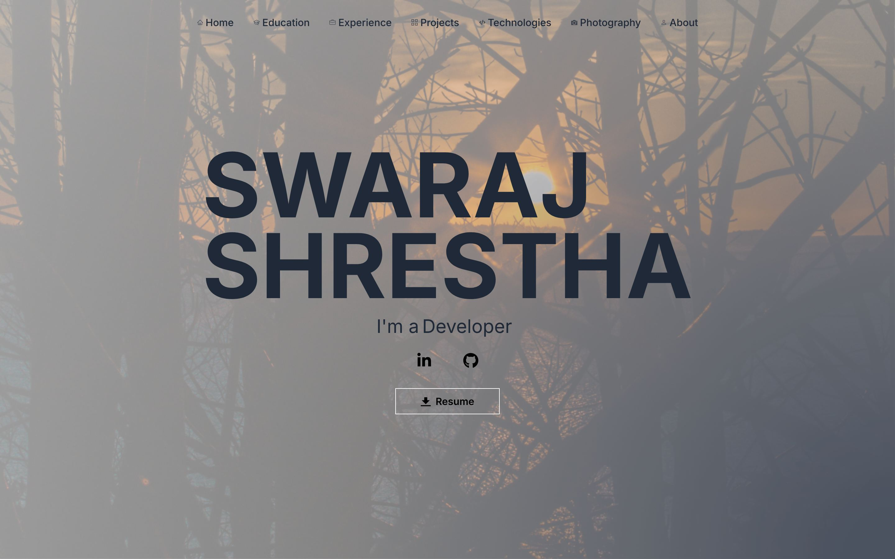
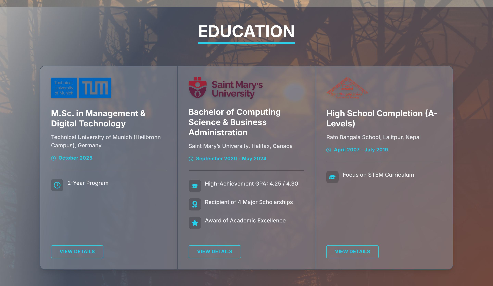
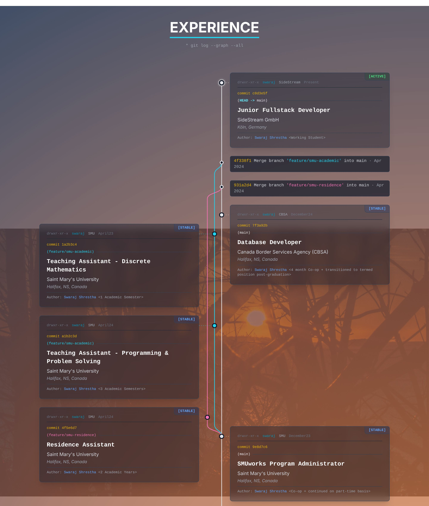
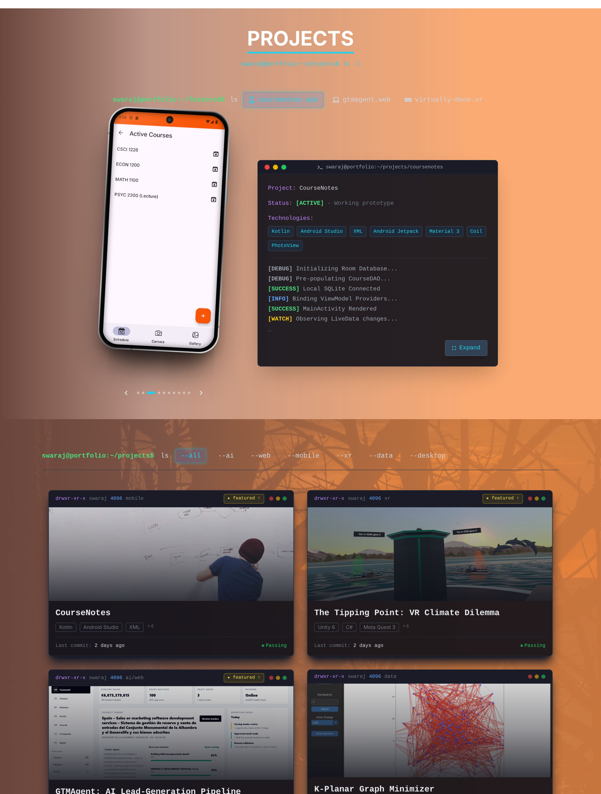
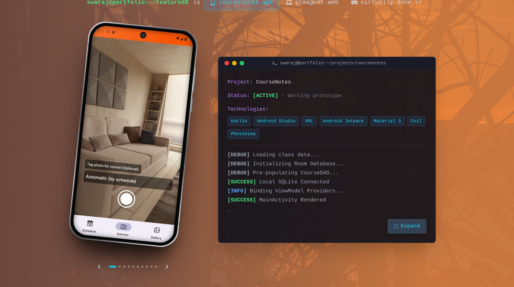
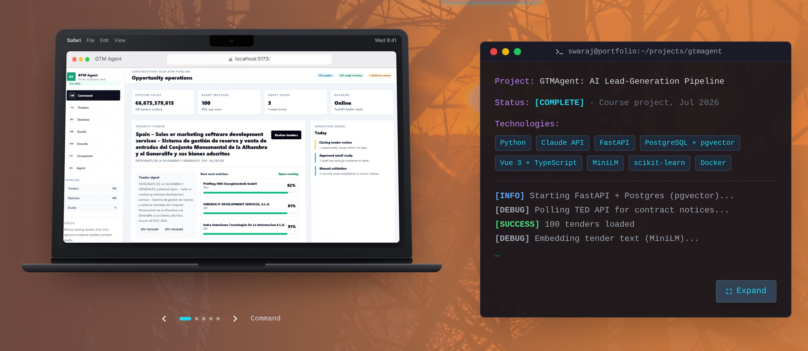
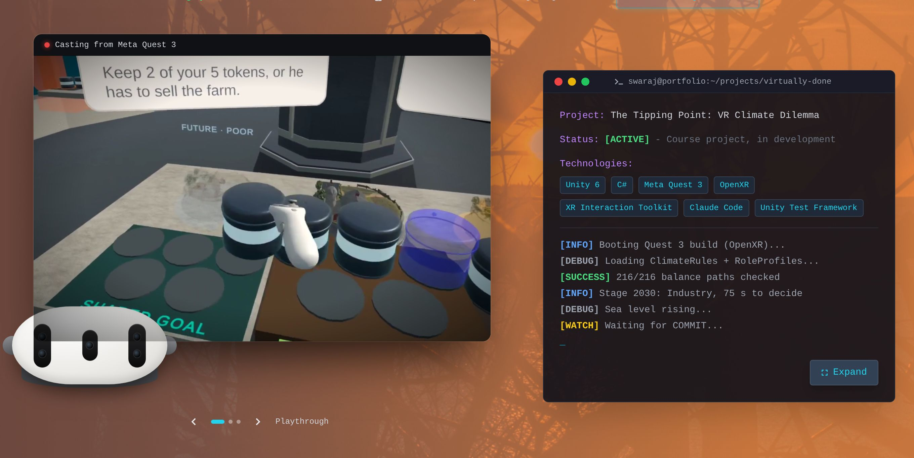
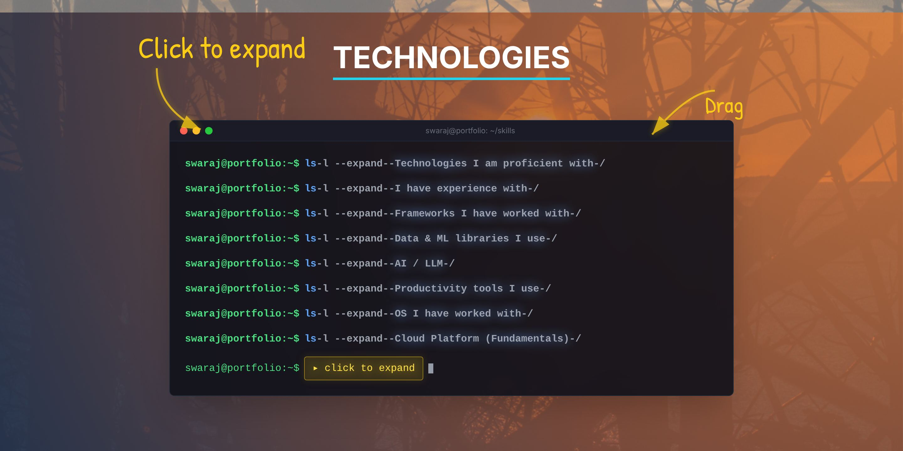
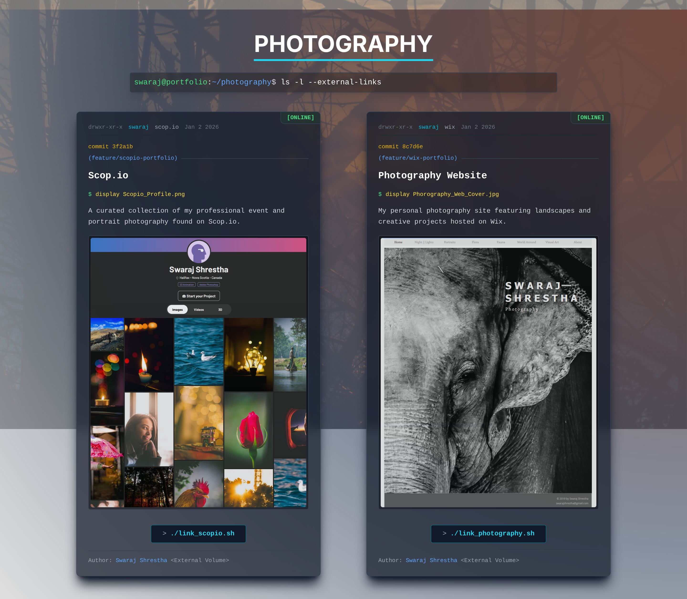
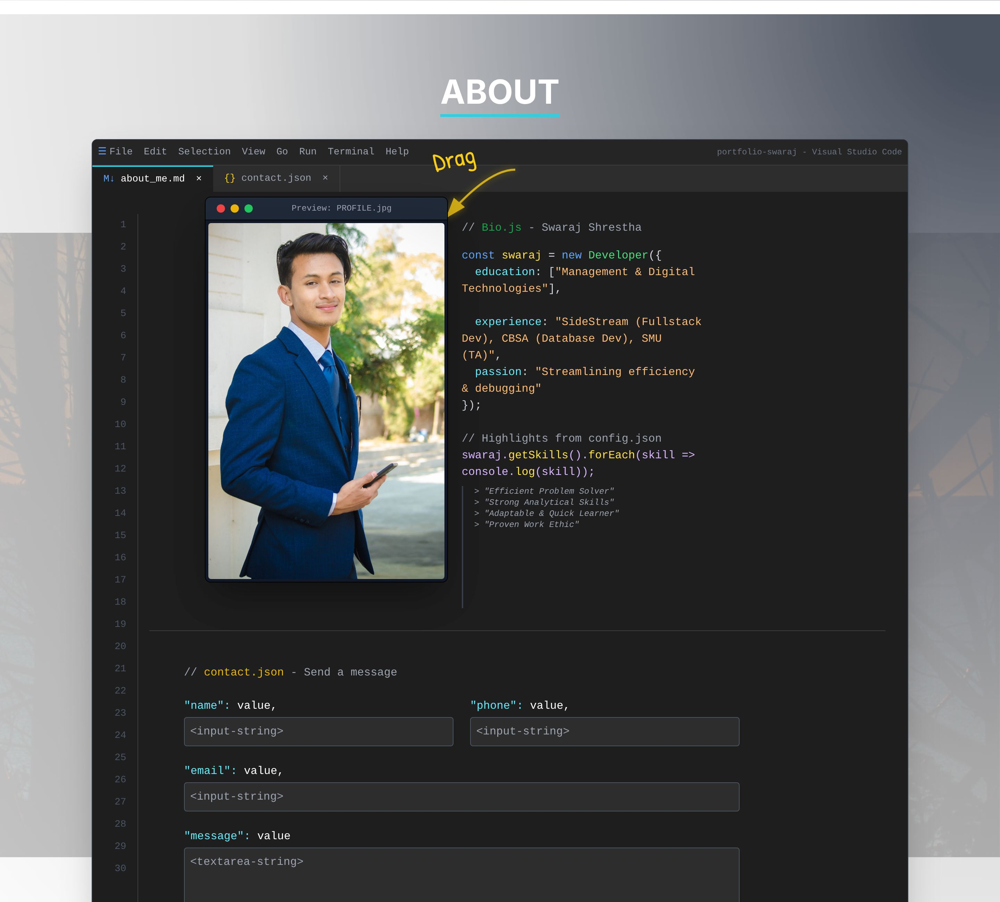

# Swaraj Shrestha – Developer Portfolio

A single-page portfolio built with React, Vite and Tailwind CSS. Each section borrows the look of a developer tool: a `git log` timeline, `ls` terminals and a VS Code window.

**Live site:** [swarajshrestha.tech](https://swarajshrestha.tech)



---

## Sections

### Home
Name, an animated "I'm a …" tagline, LinkedIn and GitHub links, and a **Resume** button that downloads [`public/Resume.pdf`](public/Resume.pdf).

### Education
One card per school (TUM, Saint Mary's University, Rato Bangala School). **View Details** opens a window with coursework, awards and scholarships.



### Experience
A timeline styled like `git log --graph`. Each role is a "commit" card with a hash, a branch (`main` or a `feature/…` branch) and an `[ACTIVE]` or `[STABLE]` tag. Clicking a card opens the full role description.



### Projects
- **Featured showcase:** switch between featured projects with `~/featured$ ls`. Each one appears on the device it was built for, next to a terminal with its status and log lines:
  - **CourseNotes** on a phone
  - **GTMAgent** on a laptop, with the browser's address bar following each page
  - **The Tipping Point** (Virtually Done) in a "Casting from Meta Quest 3" window that plays a gameplay clip

  Screens advance on their own (pausing on hover); use the dots, the arrows or the edges of the screen to move through them.
- **Project grid:** filter it with `ls --all`, `--ai`, `--web`, `--mobile`, `--xr`, `--data` or `--desktop`. A project can belong to more than one filter. Featured projects carry a **★ featured** badge that jumps to them in the showcase.
- **Project details:** clicking a project opens a VS Code-style window with a README-style write-up, screenshots and links.



| Phone | Laptop | Meta Quest 3 |
|---|---|---|
|  |  |  |

### Technologies
A terminal that lists skills in groups with `ls -l`. It starts **collapsed**: use the **click to expand** button at the bottom (or the yellow window button, or anywhere in the terminal), then click any entry to see a proficiency bar and description. On desktop the window can be dragged by its title bar and snaps back when released.



### Photography
Two terminal-style cards linking to external photography portfolios on Scop.io and Wix.



### About
A VS Code-style window with a short bio written as code (`Bio.js`), a draggable profile photo and a contact form (`contact.json`). Form submissions are sent through [Getform](https://getform.io).



---

## Tech Stack

| Purpose | Library |
|---|---|
| UI framework | [React 18](https://react.dev/) |
| Build tool / dev server | [Vite](https://vite.dev/) |
| Styling | [Tailwind CSS 3](https://tailwindcss.com/) |
| Icons | [React Icons](https://react-icons.github.io/react-icons/) |
| Typing animation (Home) | [react-type-animation](https://www.npmjs.com/package/react-type-animation) |
| Draggable windows | [react-draggable](https://www.npmjs.com/package/react-draggable) |
| Detail windows | [react-modal](https://www.npmjs.com/package/react-modal) |

**Hosting:** DigitalOcean App Platform, which deploys automatically from the `main` branch.

---

## Running Locally

Requires [Node.js](https://nodejs.org/) 18 or newer.

```bash
git clone https://github.com/SwarajStha/portfolio-Swaraj.git
cd portfolio-Swaraj
npm install
npm run dev
```

Then open http://localhost:5173.

| Command | What it does |
|---|---|
| `npm run dev` | Start the dev server with hot reload |
| `npm run build` | Build the production site into `dist/` |
| `npm run preview` | Serve the production build locally |

> **Windows PowerShell 5.1:** run each command on its own line. This version of PowerShell doesn't support chaining commands with `&&`.

---

## Updating Content

All site content lives in data arrays at the top of each component, so most updates don't need any layout changes.

| To change… | Edit |
|---|---|
| Education and coursework | `educationData` in [`src/components/Education.jsx`](src/components/Education.jsx) |
| Work experience | `experienceData` in [`src/components/Experience.jsx`](src/components/Experience.jsx) |
| Projects and project filters | `projectData` and `categories` in [`src/components/Projects.jsx`](src/components/Projects.jsx) |
| Featured showcase | Add a `showcase` block to a project in `projectData` (format documented at the top of the file); device frames are in [`src/components/showcase/`](src/components/showcase) |
| Technologies | `techSections` in [`src/components/Technologies.jsx`](src/components/Technologies.jsx) |
| Photography links | `photographyData` in [`src/components/Photography.jsx`](src/components/Photography.jsx) |
| Bio and contact form | [`src/components/Contact.jsx`](src/components/Contact.jsx) |
| Downloadable resume | Replace [`public/Resume.pdf`](public/Resume.pdf) (keep the file name) |

Images used by projects and cards go in [`public/images/`](public/images), videos in [`public/videos/`](public/videos); technology icons are in [`src/assets/`](src/assets).

---

## Credits

Technology icons for Vue, Nuxt, tRPC, FastAPI, NumPy, Pandas, scikit-learn, PostgreSQL, GitHub Actions and Claude come from [Devicon](https://devicon.dev/) (MIT licence). Icons for Zod, Prisma, Claude Code and MCP come from [Simple Icons](https://simpleicons.org/) (CC0).

---

## Contact

**Swaraj Shrestha**
- Portfolio: [swarajshrestha.tech](https://swarajshrestha.tech)
- GitHub: [@SwarajStha](https://github.com/SwarajStha)
- LinkedIn: [swaraj-shrestha](https://www.linkedin.com/in/swaraj-shrestha/)
